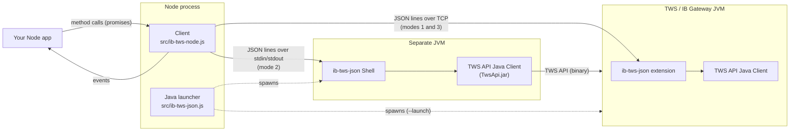
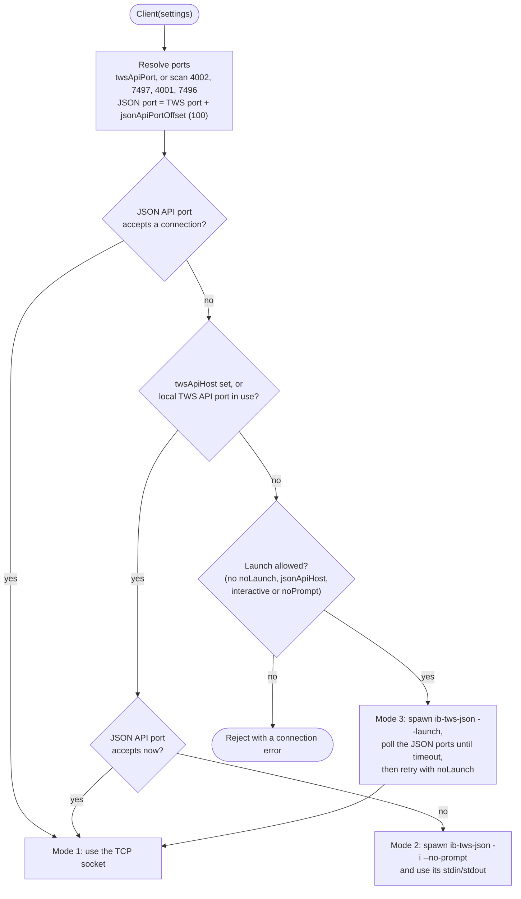

# Architecture

This document describes how ib-tws-node is put together, for people changing it. For how to use it, see [README.md](README.md).

## Overview

ib-tws-node does not implement the TWS API wire protocol. Instead it drives the official Interactive Brokers **Java Client** through [ib-tws-json](https://github.com/catch-point/ib-tws-json), a Java program that exposes the Java Client as a line-based JSON protocol. ib-tws-node's job is to:

1. find or start something that speaks that protocol,
2. learn the available methods and types from it at runtime, and
3. present them as a validated, promise-returning Node `EventEmitter`.



## Repository layout

| Path | Role |
|------|------|
| `src/ib-tws-node.js` | The library entry point (`main`). Its default export is the async client factory, which also carries the `logger` property. Chooses a connection mode, loads the schema, defines the client methods and validates calls. |
| `src/ib-tws-json.js` | The `ib-tws-json` command (`bin`) and, when imported, a factory that spawns the ib-tws-json Java process. Locates Java and `TwsApi.jar` and builds the Java command line. |
| `postinstall.js` | Downloads the files listed under `binary-dependencies` in `package.json` and verifies their SHA-256 checksums. |
| `lib/ib-tws-json.jar` | The ib-tws-json Java program. Downloaded at install time; not in git. |
| `test/` | Tests for the built-in `node:test` runner. |

External, user-supplied pieces: TWS or IB Gateway, `TwsApi.jar` from the TWS API download, and a Java runtime (normally the one bundled with TWS).

There are no npm dependencies. Everything uses the Node standard library.

## Connection modes

`createShell()` in `src/ib-tws-node.js` returns a *shell*: an object that behaves like a duplex stream of text (`write`, `end`, `destroy`, and `data` / `drain` / `close` / `error` events). In modes 1 and 3 it is a `net.Socket`; in mode 2 it is the Java `ChildProcess`, adapted to the same interface by `standAloneJsonShell()`. Everything above `createShell()` is the same in every mode.



Notes:

* Ports are probed with `net.createServer().listen()` (`scanLocalPorts`) to see whether something local is listening, and with `net.createConnection()` (`openSocket`) to see whether it accepts connections.
* `waitForLocalPorts` polls with exponential back-off (2 s, 4 s, 8 s, …) until `timeout` (default two minutes, to allow for two-factor login).
* Client settings are camelCase (`twsApiPort`); they are translated to the kebab-case flags of ib-tws-json (`tws-api-port`) in `standAloneJsonShell()` and `launchTws()`.

## Starting the Java process

`src/ib-tws-json.js` builds a command line like this:

```
[launcher ...] <java> -cp lib/ib-tws-json.jar<sep>TwsApi.jar com.meerkattrading.tws.Shell [--flags ...] [scripts ...]
```

* **Java:** `java-home` setting → the install4j JRE of the local TWS install (`.install4j/pref_jre.cfg`, `inst_jre.cfg`, or the macOS `jre.bundle`) → `JAVA_HOME` → `java` on the `PATH`.
* **TwsApi.jar:** `tws-api-jar` → a recursive search of `tws-api-path` → a recursive search of `C:\TWS API`, `~/IBJts`, `~/Jts`, `~/Downloads`, `~/Download`, `~/lib`, `~/libs`. Directories are searched highest version number first (`listNumerically`), so the newest API wins.
* **launcher:** an optional command (or array) that is run instead of Java, with the Java command line appended. Used to set up the environment, for example under `xvfb-run` on a headless server.
* **env:** merged over `process.env` for the child process.

Run directly, the same file is the `ib-tws-json` command. Its options are declared once in a table that drives both `util.parseArgs` and the generated `--help` text.

## Wire protocol

Both directions use one call per line, with fields separated by tabs. Arguments are JSON values.

```
→ placeOrder	1	{"symbol":"AAPL","secType":"STK"}	{"action":"BUY"}
← orderStatus	1	"Submitted"	0	1	0	…
← error	1	"1768779264095"	387	"Unsupported order type …"	""
```

* **Outgoing** (`send`): `name`, then each argument as `JSON.stringify(arg)`, joined by tabs and terminated by a newline. If `write()` returns `false`, `send` waits for `drain`. `exit` waits for the shell to `close`.
* **Incoming** (`emit_line`): the first token is the event name, and the rest is split on tabs and parsed as JSON. A field that is not valid JSON is passed as a raw string. Each line is emitted on the client as `client.emit(name, ...args)`, so the TWS API's `EWrapper` callbacks become client events with the same names and argument order.
* Incoming data is split into lines as it arrives; a trailing partial line is buffered until the next chunk.

## Runtime schema

The client has no hard-coded list of TWS API methods. It discovers them from ib-tws-json's `help` command when it starts, and learns parameter and type details lazily.

```
→ help
← help	"actions"	"TwsActions"       action types (method groups)
← help	"actions"	"EClient"
← help	"events"	"EWrapper"         event types
← help	"EClient"	"placeOrder"       one line per action
← help	"TwsActions"	"eConnect"
← helpEnd	null
→ help	"placeOrder"                   requested on first call
← help	"placeOrder"	"arg0"	"int"
← help	"placeOrder"	"arg1"	"Contract"
← helpEnd	"placeOrder"
→ help	"Right"                        requested when validating a Contract
← help	"Right"	"None"
← help	"Right"	"Put"
← helpEnd	"Right"
```

All of this lives in one `schema` object, keyed by name. It is built by the client's own `help` / `helpEnd` listeners:

| `help` line | Effect |
|-------------|--------|
| `help "actions" <T>` | Adds an action type `T`. |
| `help "events" <T>` | Adds an event type `T`. |
| `help <action type> <name>` | Adds action `name` and **defines `client[name]`** as an async method. |
| `help <action> <param> <type>` | Appends a parameter name and type to the action, and adds an entry for `type` if it is new. |
| `help <type> <property> <type> <default>` | Adds a property (and its default value) to an object type. |
| `help <type> <value>` | Adds an allowed value to an enum type. |
| `helpEnd <name>` | Marks the entry complete and releases everything waiting on it. |

Each entry has `requested`, `complete` and `listeners` fields. `completeItem()` sends `help "<name>"` at most once per entry and queues callers until `helpEnd` arrives, so concurrent calls share a single request and later calls are served from the cache.

The factory's promise resolves on the first `helpEnd`, when every method has been defined.

## Calling a method

Every generated method follows the same steps:

1. Make sure the action's parameter list is loaded (`completeItem`).
2. Check the number of arguments.
3. Validate each argument against its type (`assertType`), loading type definitions as needed.
4. Send the call.
5. Resolve to the client. Results arrive later as events, never as the promise's value.

Validation failures reject with an `AssertionError`. `assertType` checks:

* `[T]` types are arrays, and each element is a `T`;
* enum values are in the type's list of allowed values;
* objects only use known properties, recursively. For an unknown property it calls `assert.deepEqual` against an example built from the type's defaults, so the error shows a diff of what was expected;
* primitives: `int`/`long` are integers, `double` is numeric, `boolean` is a boolean, and `String` is not an object. Numeric strings are accepted for numbers.

`null` and `undefined` are always accepted, leaving defaults to the Java side.

This split is deliberate: **client mistakes reject the promise** of the call that made them, while **everything from TWS arrives as events**, including `error`.

## Lifecycle and shutdown

* `finished()` is true once the shell is destroyed or killed.
* When the shell closes, the client releases every queued schema waiter (so no call hangs), clears the schema and emits `exit`.
* After that, methods reject with "ib-tws-json has closed", except `exit` (resolves) and `isConnected` (emits `isConnected` with `false`).
* `kill()` destroys the shell; `ref()` / `unref()` pass through to the socket or process.
* Output on the Java process's stderr (and all output of a `--launch` process) is sent to `Client.logger.error` (a property of the default export), which defaults to `console`.

## Installation

`package.json` lists downloads under `binary-dependencies`:

```json
"binary-dependencies": {
  "lib/ib-tws-json.jar": { "url": "https://…/ib-tws-json-2.1.0.jar", "sha256": "…" }
}
```

`postinstall.js` runs for each entry:

1. Skip the download if the file already exists with the right checksum.
2. Download to `<file>.<pid>.download`, following up to 10 redirects. Anything but HTTP 200 is an error.
3. Hash the data while it streams. If the digest doesn't match `sha256`, delete the temporary file and fail.
4. Rename the temporary file into place.

Any failure exits non-zero, which fails `npm install`. A bad or missing jar never ends up in `lib/`.

## Testing

The tests use `node:test` and `node:assert`.

* `test/ib-tws-node.test.js` creates each client with `twsApiHost: 'localhost'` and `twsApiPort: 7496`, which (with no JSON API listening) selects **mode 2**: a stand-alone Java Client. It exercises schema loading, parameter validation and error events, which need Java and `TwsApi.jar` but not a logged-in TWS. Tests that need a live connection (such as `placeOrder`) are skipped.
* `test/protocol.test.js` connects a client to a fake JSON API server (mode 1) to test the wire protocol, such as lines split across chunks. It needs neither Java nor TWS.
* `test/ib-tws-json.test.js` uses Node itself as the `launcher` to capture the Java command line, and a temporary fake TWS install to test how Java is located. It needs neither Java nor TWS.

## Design constraints

* **No npm dependencies.** Keeps installs small and the supply chain short. Prefer the Node standard library.
* **ES modules, Node 20.19+ / 22.12+.** The package is `"type": "module"`. The client factory is also exported under the special name `'module.exports'`, so `require('ib-tws-node')` returns the function itself on Node versions that can `require()` ES modules; that is why `engines` requires 20.19 or 22.12. Avoid top-level `await` in `src/`, which would break `require()`. `engines` in `package.json` is the source of truth.
* **Follow the Java Client.** Names, argument order, types and enums follow the Java Client rather than being normalized (see "Differences from other TWS API clients" in the README).
* **Discover, don't generate.** Methods come from the installed TWS API at runtime, so new TWS API versions work without changing this library.
* **Pinned and verified binaries.** The ib-tws-json jar is pinned to a release URL with a SHA-256 checksum.
